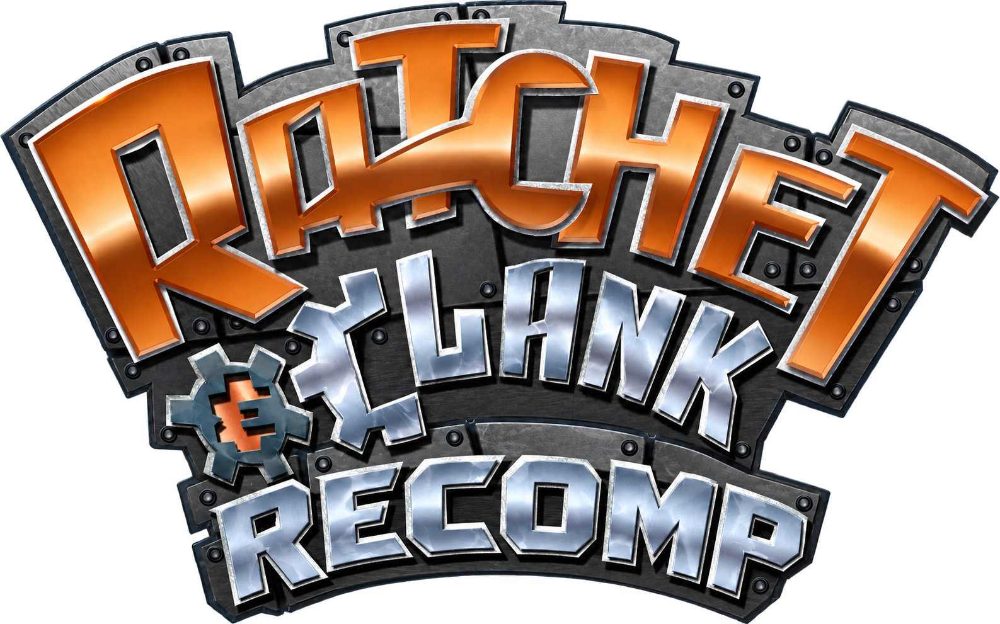
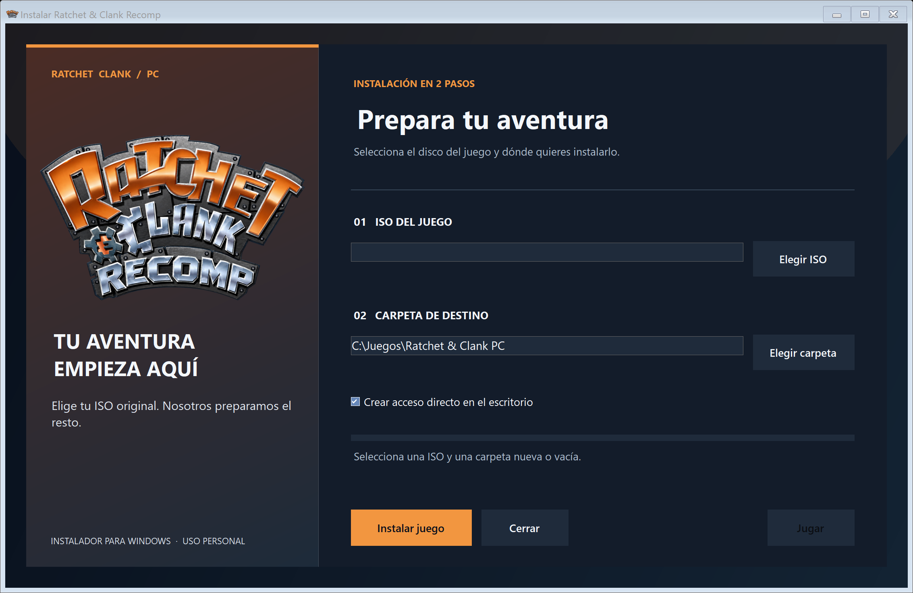
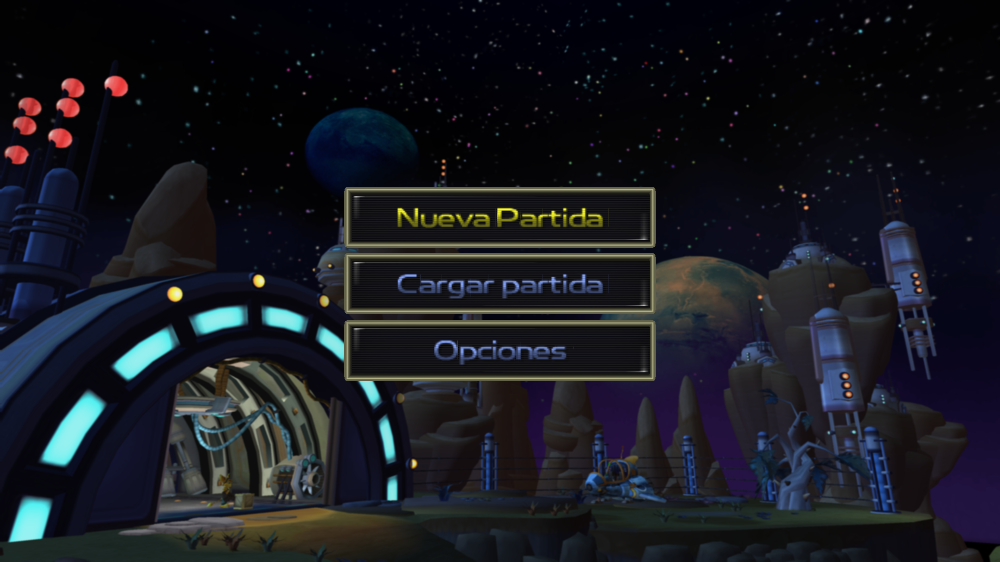
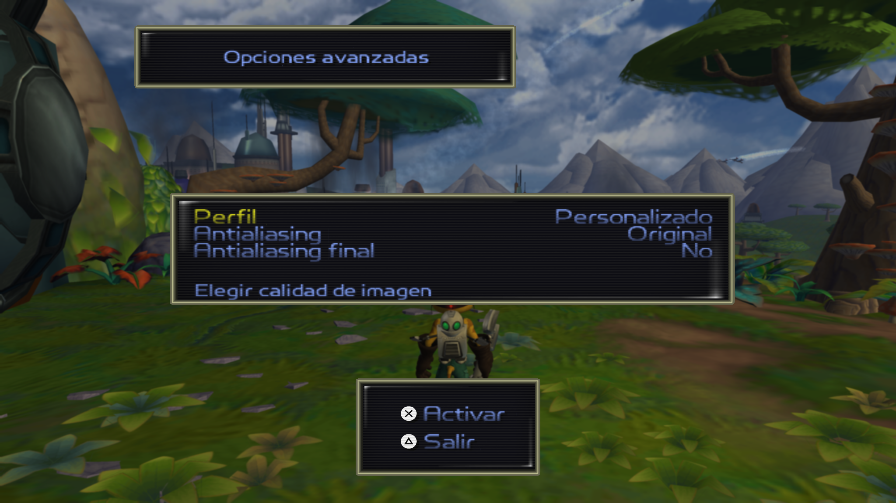
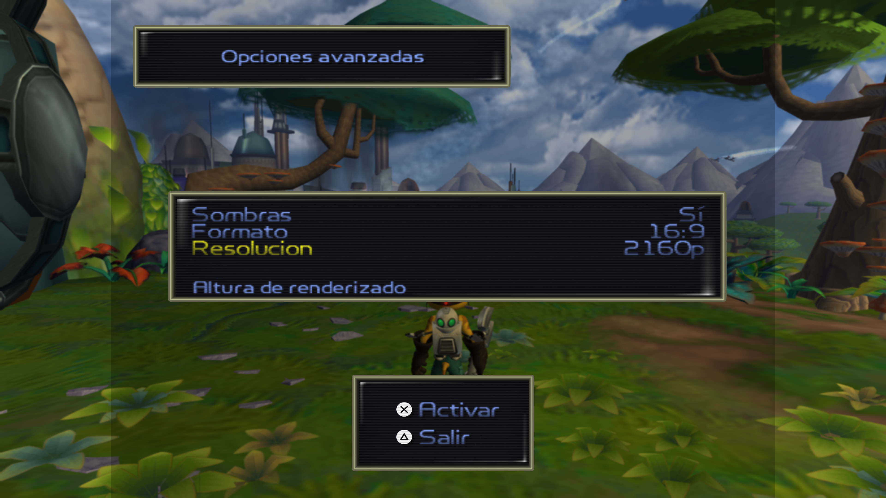
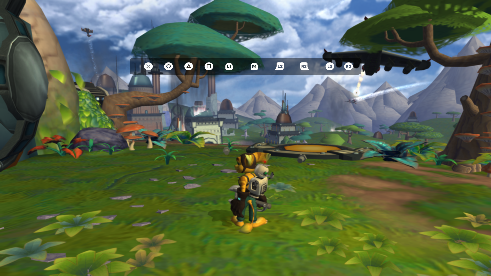
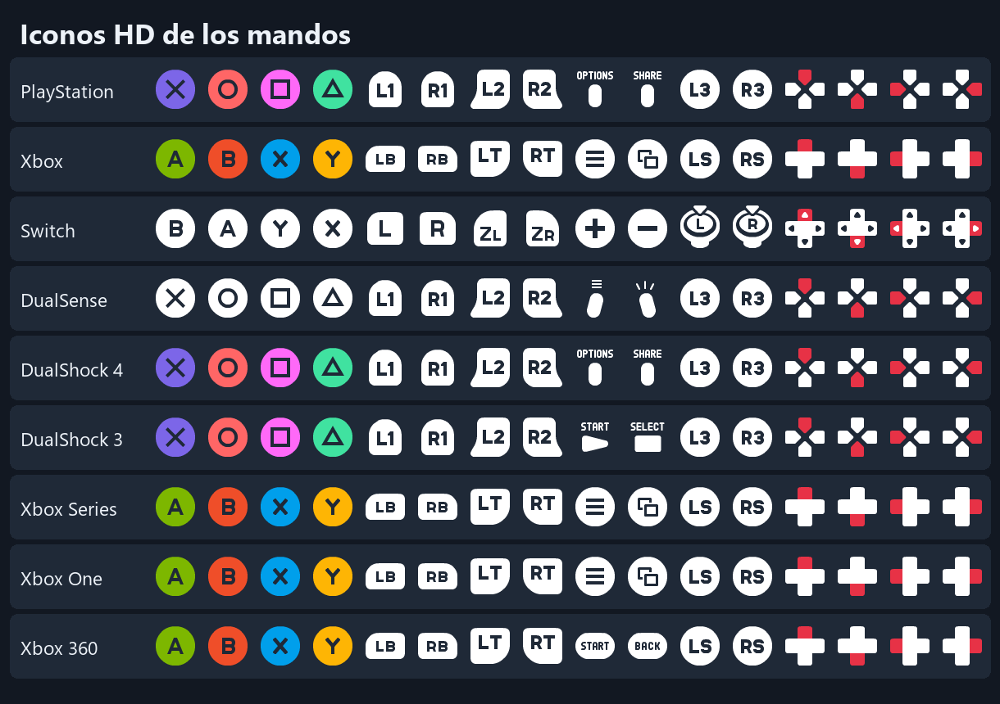

  

<h1 align="center">Ratchet & Clank Recomp para PC</h1>

Código fuente y compilación personal para Windows.

## Instalar desde tu ISO

Descarga **Instalar-Ratchet-Clank.exe** desde [la última versión](https://github.com/MarcPique/ratchet-clank-recomp/releases/latest). Elige tu ISO de *Ratchet & Clank* USA (SCUS_971.99) y una carpeta de destino nueva o vacía. El instalador verifica la ISO, extrae los datos, instala el juego y crea un acceso directo en el escritorio. La ventana del instalador usa el logo **Recomp**; el ejecutable del juego usa el logo original.

La descarga **no contiene la ISO ni datos del juego**. Todo el contenido del juego se extrae localmente de tu propia ISO. Se necesitan aproximadamente 6 GB libres durante la instalación. El repositorio es privado para conservación personal.

El instalador es **un único EXE** con el logo y los archivos necesarios integrados. Su interfaz se adapta al tamaño de la ventana y a pantallas 4K con escala alta.

[Ver el instalador maximizado a 4K](screenshots/instalador-4k.png).

## Mejoras incluidas

- Menú nativo de **Opciones avanzadas** en el menú de inicio y en las opciones durante la partida.
- Desplazamiento del menú con mando o rueda del ratón; cuadro y tipografía adaptados a distintas resoluciones.
- Perfiles de imagen **Original**, **Mejorado** y **Personalizado**; cambios aplicados desde el propio juego.
- Resolución interna hasta 2160p, escala de renderizado, relación de aspecto, monitor, frecuencia de actualización y modo ventana/pantalla completa.
- Antialiasing MSAA, FXAA y SMAA; nitidez, filtrado anisotrópico, distancia de detalle, texturas, HUD y sombras.
- Sincronización vertical, límite de FPS y visualización de rendimiento.
- Idioma del juego: inglés, francés, alemán, **español** e italiano.
- Iconos HD automáticos o manuales para DualSense, DualShock 3/4, Xbox 360/One/Series y Nintendo Switch.
- Sensibilidad de cámara, zona muerta, vibración de cámara, tamaño y contraste de subtítulos.
- Interfaz y texto preparados para 720p, 1080p y 4K; iconos corregidos para evitar duplicación visual.
- Ventana llamada **Ratchet & Clank**, icono original en la ventana, barra de tareas y ejecutable, y apertura sin terminal visible.

## Capturas reales

Capturas del juego a 3840 × 2160, tomadas en segundo plano. La [galería completa](screenshots/README.md) incluye las secciones principales de los ajustes gráficos y los nueve estilos de iconos de mando.

| Menú principal | Opciones avanzadas |
| --- | --- |
|  |  |

| Resolución y formato | Iconos DualSense |
| --- | --- |
|  |  |

### Todos los estilos de iconos

También hay capturas dentro del juego para [DualSense](screenshots/iconos-dualsense-4k.png), [Xbox Series](screenshots/iconos-xbox-series-4k.png) y [Nintendo Switch](screenshots/iconos-switch-4k.png). La [galería completa](screenshots/README.md) reúne las nueve familias.

## Código fuente

`crates/` contiene el motor, los menús, la extracción y las bibliotecas del juego. `installer/` contiene el instalador gráfico. `scripts/` construye el paquete Windows y el instalador. `assets/` contiene el logo Recomp del repositorio e instalador; el logo original del juego está en `crates/rc-engine/assets/`. `screenshots/` contiene las capturas de prueba.

Para recompilar en Windows:

1. Instala Rust y .NET 8 SDK.
2. Ejecuta `cargo build --release -p rc-engine -p rc-extract`.
3. Ejecuta `scripts/Build-GameBundle.ps1` con `-GameExe`, `-ExtractorExe`, `-ShadersDirectory`, `-LicenseFile` y `-OutputDirectory`.
4. Ejecuta `scripts/Build-Installer.ps1` con `-BundleZip` y `-OutputDirectory`.

El ZIP de compilación que se incrusta en el instalador se genera localmente y está excluido de Git. El juego necesita los datos de tu ISO para iniciarse. Los avisos obligatorios de autoría y licencia están en [LICENSE](LICENSE); *Ratchet & Clank* pertenece a sus respectivos titulares.
